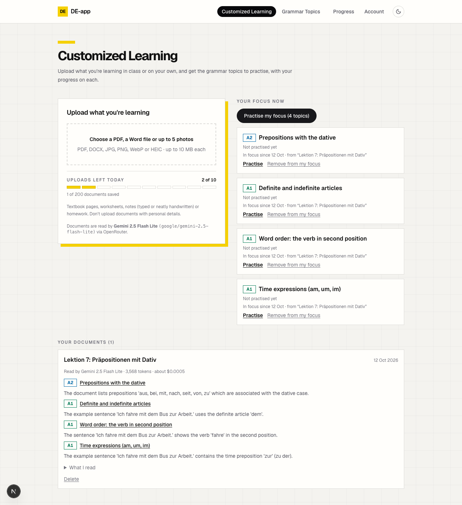

# DE-app

**Upload what you're learning in German class, and get your own grammar practice plan.**

Live: https://de-app-six.vercel.app

## What it does

1. **Customized Learning** (`/learning`, logged in). Upload a worksheet, textbook page, typed or neatly handwritten notes, or homework: one PDF (at most 20 pages), one Word file, or up to 5 photos (JPG, PNG, WebP, HEIC), 10 MB each. You see the chosen files (with photo previews) before anything is uploaded; then an AI model reads it and picks the 1–6 grammar topics it clearly practises from a fixed catalogue of 82 A1–C2 topics, mistakes first, each with a reason quoting your document. The result is saved, and the original file is deleted straight after reading.
2. **Your focus now.** The topics from your uploads of the last 30 days, ranked by mistakes and how often they come up, with your progress on each. Remove a topic, or add one from any topic page.
3. **Practise my focus** (`/learning/practice`). One mixed round of exercises from exactly your focus topics.
4. **Grammar Topics** (`/topics`, open to everyone). The 82-topic catalogue. Each topic has a practice page with 30 checked exercises (pick the answer, type the word, put the words in order), rounds of 10, an explanation after each answer, and "Practise my mistakes". Correct answers move on by themselves after 1.5 s (each learner can change that to 3 s, or to waiting for a click or Enter); after a mistake, click anywhere or press Enter (on the der · die · das cards, also after a correct answer on a card with an exception note). ← / → move between answers. The practice pages are labelled "still in test mode".
5. **der · die · das** (`/articles`). The original flashcard game for noun gender: 1,286 A1–C2 nouns (pick A, B, C or All), every answer explained by its rule, answered the same way (← / → and Enter work too).

**Why AI is the core.** The catalogue and exercises are generic. The AI is what connects them to *your* lessons: it reads your own material and decides what you should practise now. Without it the app wouldn't know what you're learning.

Guests can browse topics and practise without saving. Signed-out visitors who open Customized Learning, Progress or Account are sent to the login page.

## The AI feature

| | |
|---|---|
| Model | `google/gemini-2.5-flash-lite` via [OpenRouter](https://openrouter.ai) (shown in the app as "Gemini 2.5 Flash Lite") |
| Where the call happens | `lib/learning/analyse.ts` (server-only), called from the server action in `app/learning/actions.ts` |
| Prompt | `lib/learning/prompt.ts`: the instructions and topic catalogue as the system message, with a `PROMPT_VERSION`; the uploaded document in its own user message, treated as untrusted content |
| Input | PDF as a `file` part with the `file-parser` plugin set to the `native` engine (pages counted with pdf-lib first); photos as base64 `image_url` parts; Word files read with mammoth (after a zip-bomb size guard) and sent as text |
| Output | Strict JSON schema from one Zod schema (`lib/learning/suggestions.ts`): title, the text read, "no grammar" flag, 1–6 topics with reasons. Four outcomes: topics found, no grammar, unreadable (not saved, still counts) and an invalid answer (not saved, still counts; never shown as "no grammar"). Topics outside the catalogue are dropped |
| Cost | About $0.0005 for a one-page worksheet, up to about $0.002 for several textbook pages (both measured on 2026-10-12; see `docs/testing.md`). Each document card shows the model, tokens and cost from OpenRouter's response |
| Limits | 10 uploads per learner and 100 for everyone in any 24 hours (an upload is given back only if no paid AI answer came back: a network failure or an error from OpenRouter. A timeout, a cut-off or unusable answer, a failed save or a photo with no readable text still counts), 200 saved documents per learner, at most 5 files in a learner's upload folder (all enforced by the database) |

Details and the OpenRouter references: [`docs/openrouter-multimodal.md`](docs/openrouter-multimodal.md).



## Optional task

**Showing which model read each document and how many tokens it used.** Every saved document records the model, prompt and completion tokens and cost from OpenRouter's response (`lib/learning/usage.ts`, stored per document), and the card shows them: "Read by Gemini 2.5 Flash Lite · 3,568 tokens · about $0.0005". The upload box also names the model before you upload.

Built with Next.js (App Router), TypeScript, Tailwind CSS 4, Supabase (auth, Postgres with row-level security, Storage) and OpenRouter, deployed on Vercel.

## Setup

Needs Node 24 (`.nvmrc`; `nvm use` picks it up) and npm. Everything the app needs is in the repo: the flashcard deck (`lib/flashcards/data/`), the 81 exercise files (`lib/exercises/data/`), the migrations and auth config (`supabase/`) and the docs (`docs/`).

```bash
npm ci                       # exact versions from package-lock.json
cp .env.example .env.local   # then fill in the values below
npm run dev                  # http://localhost:3000
```

A clean build from scratch: `rm -rf node_modules .next && npm ci && npm test && npm run build`.

| Variable | Where to find it | Notes |
|---|---|---|
| `NEXT_PUBLIC_SUPABASE_URL` | Supabase → Project Settings → API | Public by design |
| `NEXT_PUBLIC_SUPABASE_PUBLISHABLE_KEY` | Supabase → Project Settings → API Keys | The publishable (anon) key; safe in the browser, row-level security protects the data |
| `SUPABASE_SECRET_KEY` | Supabase → Project Settings → API Keys | **Server-only** (`lib/supabase/admin.ts`, which the build refuses to put in browser code). It skips row-level security, so every query through it is pinned to the signed-in user's id. Used for exactly three things: saving a document after a counted AI read (learners can't insert documents themselves), giving an upload back when the AI read failed with no paid answer (both in `app/learning/actions.ts`), and "Delete my account", which empties the user's upload folder and deletes the user, whose rows go with them (`app/account/actions.ts`). Never prefix with `NEXT_PUBLIC_` |
| `OPENROUTER_API_KEY` | OpenRouter → Keys | **Server-only**, used only in `lib/learning/analyse.ts`. Never prefix with `NEXT_PUBLIC_` |

`.env.local` is git-ignored (`.env*` in `.gitignore`, except `.env.example`, which holds no values). On Vercel the two secret keys are set for Production only and marked Sensitive.

### Database and auth settings

The schema lives in `supabase/migrations/` and the auth settings and email templates in `supabase/config.toml` and `supabase/templates/`. With the Supabase CLI logged in (`npx supabase login`, run in a real terminal):

```bash
npx supabase db push --project-ref <ref> --dry-run   # see which migrations are pending
npx supabase db push --project-ref <ref>             # apply them
npx supabase config diff --project-ref <ref>         # then config push to apply auth settings
```

Every table with user data has row-level security with owner-only policies, and signed-out visitors have no access at all. Table design and access rules: [`docs/supabase-schema.md`](docs/supabase-schema.md).

## Scripts and tests

| Command | What it does |
|---|---|
| `npm run dev` | Dev server |
| `npm run build` | Production build |
| `npm run lint` | ESLint |
| `npm test` | Unit tests (`lib/**/*.test.mjs`, Node's built-in test runner): upload rules, AI answer parsing and its four outcomes, Word reader (incl. the zip-bomb guard) and PDF page count, auto-advance setting, focus list and focus practice, usage display, flashcard progress and trouble words, safe login redirects, exercise checking, and validation of all 81 exercise files |
| `npm run sync:exercises` | After editing `lib/exercises/data/*.json`: regenerate `lib/exercises/sets.ts` and the practice links |
| `npm run db:start` / `npm run db:stop` | Start or stop a throwaway local Supabase with every migration applied (needs OrbStack or Docker). The database and browser tests run only against it, never the live project |
| `npm run test:db` | Database tests (pgTAP, `supabase/tests/database/`): one user can't read, change or delete another user's documents, focus list, answers, upload counter or files; the upload allowance; answer ids counted once |
| `npm run test:e2e` | Browser tests (Playwright Test, `e2e/*.spec.ts`) with a fake OpenRouter: every upload kind and outcome, the review step, focus, a **second user can't see the first user's documents**, failed reads and saves with retry, practice pages, keyboard, auto-advance setting, der · die · das, phone width with the keyboard open. A failed test keeps a trace (`npx playwright show-report`) |
| `npm run test:smoke` | The one test with the real model (about $0.0005): the Lektion 7 PDF gets dative topics. Run it before merging a change to the prompt, the AI request or the answer schema |
| `npm run db:types` | Once a migration is applied to the live project: regenerate `lib/supabase/database.types.ts` from it (formatted output; `--local` works too but prints unformatted code) |

How to run them, and what each test checks: [`e2e/README.md`](e2e/README.md). Latest results: [`docs/testing.md`](docs/testing.md).

**New packages wait 7 days.** `.npmrc` sets `min-release-age=7`, so npm only picks package versions published at least 7 days ago. If `npm install <pkg>`, `npm update` or `npm audit fix` fails with `ETARGET` "No matching version found ... with a date before ...", the version you asked for is too new: wait, or pin an older version. Exempting one package (`min-release-age-exclude[]=<pkg>` in `.npmrc`) needs a reason and review. Versions already in `package-lock.json` are not re-checked, and global installs (`npm i -g`) and commands run outside this folder are not covered.

## How changes are made

Each change goes through a feature branch and a GitHub pull request. The `ai-code-reviewer` agent ([`.claude/agents/ai-code-reviewer.md`](.claude/agents/ai-code-reviewer.md)) reviews the PR before it's merged. It reads the diff in a fresh context and reports dead code, duplication, over-engineering and silent behaviour changes as Critical / Warning / Suggestion. Each review request also listed the course's AI and security rules to check, and the reports record those checks. Its report is saved in [`docs/reviews/`](docs/reviews/) and posted on the PR:

- PR #1 Show the AI model and cost of each document: [report](docs/reviews/pr-1-model-and-cost.md)
- PR #2 Add Practise my focus and send signed-out visitors to login: [report](docs/reviews/pr-2-practise-my-focus.md)
- PR #3 Document the AI feature, rules, references and test results: [report](docs/reviews/pr-3-docs.md)
- PR #4 Guard server-only data files and clean up the upload counter: [report](docs/reviews/pr-4-server-only-and-cleanup.md)
- PR #5 Add the ai-code-reviewer agent to the repo: [report](docs/reviews/pr-5-ai-code-reviewer-agent.md)
- PR #6 Tidy up: safer theme toggle, shared helpers, accurate limit messages: [report](docs/reviews/pr-6-refactor-cleanup.md)
- Later PRs: one report per PR in [`docs/reviews/`](docs/reviews/) (`pr-<number>-<topic>.md`).

Security scans (`/security-scan`, `/security-scan-changed`) run with three scanner agents (Supabase, Next.js, Vercel). The Supabase scanner also runs the same database checks as the dashboard's **Security Advisor** (Supabase's open-source "splinter" checks, a pinned and hash-checked version, read-only) and says for each item whether it's a real problem or intended. `upload_allowance()` and `use_upload_quota()` are SECURITY DEFINER on purpose (the advisor warns about every such function signed-in users can call): they count the shared daily limit across all users and are the only way to write the upload counter, so learners can't forge or reset it. Auth-only advisor items (e.g. leaked-password protection, which needs the Pro plan) are checked in the dashboard.

## Project layout

| Path | What's there |
|---|---|
| `app/learning/` | Customized Learning page, the upload/delete/focus server actions, and Practise my focus |
| `lib/learning/` | Upload rules, the prompt (`prompt.ts`), the OpenRouter call (`analyse.ts`), the AI answer schema and checks (`suggestions.ts`), Word and PDF reading (`documents.ts`), focus list, progress, usage display |
| `components/learning/` | Upload box, focus list, document list, Add-to-focus button |
| `app/topics/` | Grammar Topics library, topic pages, practice pages and the answer-saving server action |
| `lib/exercises/` | Exercise types, answer checking, the 81 exercise files (`data/`) and the generated index |
| `components/exercises/ExerciseSession.tsx` | The practice round UI |
| `components/UnsavedAnswers.tsx`, `components/AdvanceSetting.tsx`, `components/LoadError.tsx` | Unsaved-answer note with Retry, the auto-advance setting, and the "Couldn't load · Try again" message |
| `app/articles/`, `components/ArticlesGame.tsx` | der · die · das flashcards |
| `app/progress/`, `app/account/`, `app/login`, `app/auth/*` | Progress, account (log out, delete account), login, sign-up, password reset, callbacks |
| `lib/supabase/` | Browser, server, admin and proxy Supabase clients, typed with the generated `database.types.ts`; `proxy.ts` sends signed-out visitors away from `/learning`, `/progress` and `/account` |
| `supabase/` | Migrations, auth config, email templates, database tests (`tests/database/`, pgTAP) |
| `e2e/` | Browser tests (Playwright Test), the fake OpenRouter and fixtures |
| `docs/` | Schema, OpenRouter reference, testing results, PR reviews, design specs and plans |

## Known limits

- Recommendation quality isn't measured yet: an evaluation set of human-reviewed worksheets (clean, corrected, ambiguous, unreadable) is the next step (see [`docs/todo.md`](docs/todo.md)). Until then, the "mistake" labels on teacher corrections are untested.
- Neat handwriting is read well, but the AI still guesses unclear words (it never wrote `[?]` in testing) and can keep crossed-out words. Teacher correction marks on handwritten pages are untested. A photo with no readable text is refused and not saved.
- Passwords must be at least 10 characters with upper- and lower-case letters and a number (`supabase/config.toml`, the same rule in the sign-up form). Supabase's check against passwords leaked in data breaches ("Leaked Password Protection", flagged by the Security Advisor) needs the Pro plan, so it is off. Existing accounts keep their passwords until they change them. "Continue with Google" needs no password.
- Emails are sent through Brevo's free plan (300/day) from a Gmail sender, so some may land in spam. A custom domain would fix that.
- Stats are computed from a user's whole answer history on each page load. That's fine for thousands of answers; move it into SQL if histories get much larger.
- The 100-uploads-a-day app-wide cap protects the AI budget but can be used up by about 10 accounts.
